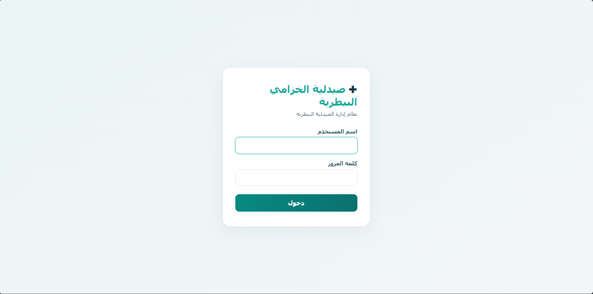
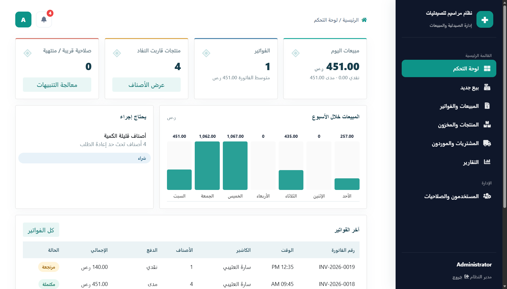
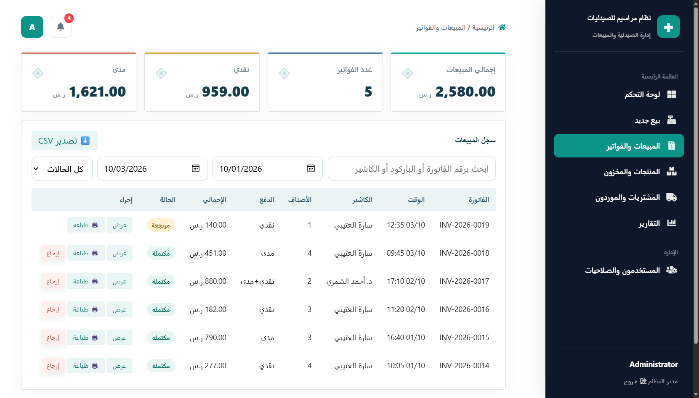
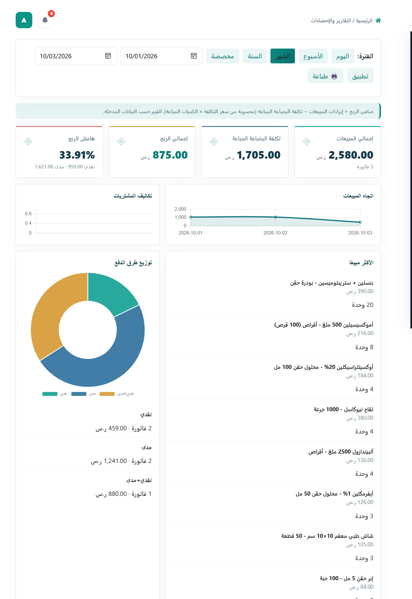

# 🐾 Maraseem Digital — Veterinary Pharmacy & POS System
> **نظام مراسيم ديجيتال لإدارة الصيدليات البيطرية ونقاط البيع**


A complete, production-ready **Pharmacy Management & Point of Sale (POS)** application built for veterinary medicine dispensaries. Features offline-first cryptographic licensing, automated barcode scanning, stock batch lifecycle tracking, and Saudi VAT-compliant receipt generation.

---

## 📸 Screenshots & System Interface

<div align="center">

### 🔑 Authentication & Login
*Clean, responsive login with security enforcement.*
<br>


<br><br>

### 📊 Executive Dashboard
*Real-time sales summaries, stock movement alerts, and quick actions.*
<br>


<br><br>

### 🛒 Point of Sale (POS) & Checkout
*Rapid barcode scanning, instant line totals, and thermal receipt printing.*
<br>


<br><br>

### 📦 Procurements & Supplier Stock Management
*Track incoming supplier batches, cost prices, and batch expiration dates.*
<br>


</div>

---

## ✨ Key Features

* **⚡ Ultra-Fast POS Terminal:** High-speed barcode reader input (USB/HID) with quick item lookup, manual overrides, and multi-payment support (Cash/Card).
* **🖨️ Thermal & Standard Invoicing:** Auto-formatted 58mm / 80mm thermal receipt previews compliant with local VAT layout standards.
* **🛡️ Offline Cryptographic Engine:** 
  * **Hardware ID Binding:** Unique device fingerprinting preventing unauthorized license replication.
  * **AES-256-CBC Encryption:** Encrypted local runtime license metrics (`sys_metrics.dat`).
  * **RSA-256 Serial Verification:** Asymmetric activation key validation.
  * **Anti-Time-Tampering:** High-watermark time verification utilizing sales database timestamps to block system clock rollbacks.
* **📦 Inventory & Stock Control:** Smart low-stock threshold alerts, zero-quantity auto-hiding, and batch expiration tracking.
* **📑 Procurement Management:** Manage supplier orders, track receiving history, and update inventory cost points seamlessly.
* **📊 Business Reports:** Analytics on net sales, category profit margins, and exportable financial reports.

---

## 🛠️ Tech Stack & Requirements

* **Language:** PHP 8.0+ (PDO & OpenSSL extensions required)
* **Database:** MySQL 8.0+ / MariaDB
* **Security:** Bcrypt Password Hashing, CSRF Tokens, OpenSSL Cryptography
* **Frontend:** Modern RTL Layout, Custom Responsive CSS, Vanilla JavaScript

---

## 📁 Repository Structure

```text
htdocs/
├── index.php                 # Main Dashboard & Metrics
├── login.php                 # Authentication Page
├── logout.php                # Session Destruction
├── includes/
│   ├── config.php            # Core DB Connection & App Settings
│   ├── subscription.php      # Offline RSA/AES License Engine
│   ├── protection.php        # Access Control & CSRF Protection
│   ├── company_info.php      # Pharmacy Info & VAT Config
│   └── layout.php            # Primary UI Template & Navigation
├── pos/
│   ├── index.php             # POS Barcode Checkout Interface
│   └── checkout.php          # Transaction Processor
├── sales/
│   ├── index.php             # Historical Sales & Invoices
│   ├── bill_detail.php       # Printable Receipt View
│   └── return.php            # Refund & Item Return Logic
├── stock/
│   ├── index.php             # Product & Inventory Directory
│   ├── label.php             # Barcode Label Printing
│   └── save_product.php      # Inventory CRUD Operations
├── procurements/
│   ├── index.php             # Supplier Invoices & Batch Intake
│   └── save.php              # Intake Data Processor
├── reports/
│   ├── index.php             # Financial Reports & Profitability
│   └── print.php             # Printable Analytics Sheets
└── users/
    ├── index.php             # User Management
    └── save.php              # User Privilege Controller
